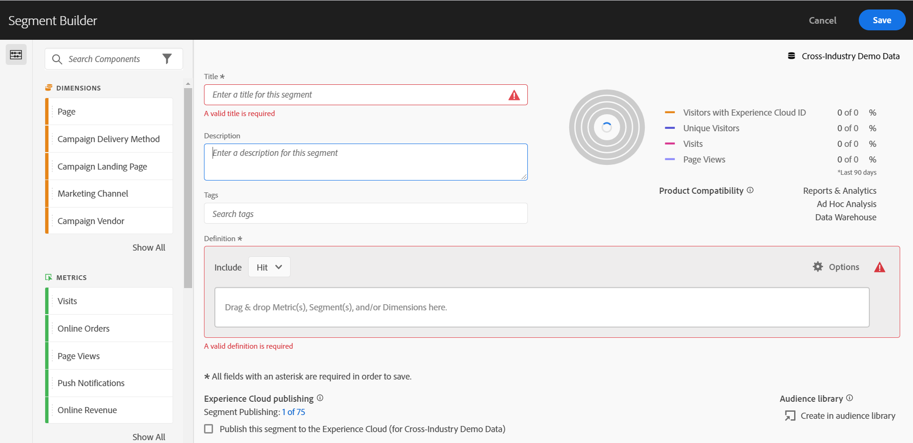

# Analysis Workspace 的協助工具

了解 Customer Journey Analytics 的主要分析工具 [!UICONTROL Analysis Workspace] 中的協助工具支援。

協助工具旨在讓產品適用於在視覺、聽覺、認知、運動能力和其他方面有障礙的人士。 軟體產品的輔助功能範例包括：

* 螢幕閱讀器支援、
* 圖形等效文字、
* 鍵盤快速鍵、
* 將顯示顏色變更為高對比度，
* 及更多內容。

[!UICONTROL Analysis Workspace] 提供了一些方便使用的工具，包括：

## 鍵盤導覽

[!UICONTROL Analysis Workspace] 中的導覽可由上至下、由左至右運作。 以下導覽元素有助於提升協助工具的可用性：

* **[!UICONTROL Tab]** 鍵會啟用地標快速鍵，從而在 Workspace 中較大的區段之間移動。 在左側面板中，**[!UICONTROL Tab]** 鍵也可讓您在不同的可拖曳選項之間移動。
* **[!UICONTROL Tab]** 鍵醒目標示一個元素後，◀◀︎ 和▶ ▶︎ 會在個別元素之間移動。
* **[!UICONTROL F6]** 鍵會導覽至專案中的第一個面板，並在該面板內的視覺效果之間移動。 然後它會移到專案中的下一個面板，然後重複此程序。
* 套用焦點指標，讓視力不佳的鍵盤使用者能夠清楚看出目前取得焦點的 UI 元素。 此指示器是具有焦點的藍色邊框面板。 灰色背景表示最近選取的功能和功能內的選擇。 在範例中，最近選取了「[!UICONTROL 元件]」和「頁面尺寸」。

  

### 功能表列的鍵盤導覽

1. 按 Tab 鍵，直到抵達功能表列為止。
1. 使用箭頭鍵在選單和選單項目之間導覽。
1. 按 **[!UICONTROL Enter]** 以開啟選單或選取選單項目。
1. 使用 **[!UICONTROL Esc]** 以關閉選單。

### 拖放互動的鍵盤導覽

[!UICONTROL Analysis Workspace] 是著重於拖放功能的使用者介面。 但使用者也可改用鍵盤新增元件：

1. 以 Tab 切換至左側面板中的元件。
1. 按 **[!UICONTROL Enter]** 以進行選取。
1. 使用方向鍵導覽至您要放置元件的區域。
1. 按 **[!UICONTROL Enter]** 以放置元件。

### 表格欄的鍵盤導覽 {#table-columns}

您可以使用鍵盤調整表格欄的大小和重新排清單格欄。 相同的金鑰適用於macOS和Windows。

#### 調整欄大小 {#resize-columns}

您可以使用欄大小調整分隔符號（兩個欄標題之間的界限）來調整自由格式表格和同類群組表格中的欄大小。

1. 按下&#x200B;**[!UICONTROL Tab]**，直到資料行調整大小分隔符號具有焦點為止。

   當分隔符號具有焦點時調整顯示大小的指示。 熒幕助讀程式會朗讀這些指示和目前欄寬的百分比。

1. 使用下列鍵調整欄大小。 欄的大小不能超過其最小或最大寬度。

   | 索引鍵 | 動作 |
   | --- | --- |
   | **[!UICONTROL 向左鍵]** | 將分隔符號左側的欄縮小10畫素。 |
   | **[!UICONTROL 向右鍵]** | 將分隔符號左側的欄加寬10畫素。 |
   | **[!UICONTROL 輸入]** | 重設欄寬。 |

#### 重新排列欄 {#rearrange-columns}

在您可以編輯的自由格式表格中，您可以使用欄標題中的&#x200B;**[!UICONTROL 重新排列]**&#x200B;功能表將欄左右移動。

1. 按下&#x200B;**[!UICONTROL Tab]**&#x200B;直到欄標題中的&#x200B;**[!UICONTROL 重新排列]**&#x200B;按鈕成為焦點。
1. 按下&#x200B;**[!UICONTROL Enter]**、**[!UICONTROL 空間]**&#x200B;或&#x200B;**[!UICONTROL 向下鍵]**&#x200B;以開啟功能表。
1. 選取&#x200B;**[!UICONTROL 將資料行左移]**&#x200B;或&#x200B;**[!UICONTROL 將資料行右移]**。

   若要關閉功能表而不移動欄，請按&#x200B;**[!UICONTROL Esc]**。 焦點返回&#x200B;**[!UICONTROL 重新排列]**&#x200B;按鈕。

   移動欄之後，熒幕助讀程式會朗讀欄名稱及其群組中的新位置。

使用鍵盤重新排列欄時，請考量下列事項：

* 欄只會在其同層級欄群組中移動，這些同層級欄位於相同父標頭下的相同層級。 您不能使用鍵盤將欄移動到不同的群組或複製欄。
* 當您移動父系標題時，其巢狀欄和篩選器會隨之移動。
* 已針對群組中的第一欄停用&#x200B;**[!UICONTROL 向左移動欄]**。 **[!UICONTROL 已針對群組中的最後一欄停用向右移動欄]**。
* **[!UICONTROL 重新排列]**&#x200B;按鈕僅適用於您也能透過拖曳來重新排列的欄。 它不適用於下列專案：
  * 唯讀表格或停用互動的表格。
  * 具有[多個維度欄](/help/analysis-workspace/visualizations/freeform-table/freeform-table-multidimensions.md)的自由格式表格，您無法拖曳欄。
  * 同類群組表格中的日期欄。

### 鍵盤快速鍵 (熱鍵)

[!UICONTROL Analysis Workspace] 提供一組豐富的[鍵盤快速鍵 (快速鍵)](/help/analysis-workspace/build-workspace-project/fa-shortcut-keys.md)，讓工作流程更加順暢。

## 支援螢幕助讀程式和螢幕放大鏡

螢幕助讀程式會讀出顯示在電腦螢幕上的文字。 它還讀取非文字資訊，例如應用程式按鈕標籤或影像說明。

## 調色盤和對比

[!UICONTROL Analysis Workspace] 致力於達到 WCAG 2.1 AA 的要求，包括色彩對比的要求。

此外，使用者可在&#x200B;**[!UICONTROL 專案]** > **[!UICONTROL 專案設定]** > [專案調色盤](/help/analysis-workspace/build-workspace-project/color-palettes.md)下，針對專案設定自己偏好的調色盤。

## 所需的驗證

建置元件、視覺效果或面板，儲存時會驗證必填欄位。 如果必要欄位未通過驗證，則會以紅色外框標示並顯示錯誤圖示。 文字說明會解釋需要修正的內容。

## 支援作業系統協助工具功能

Analysis Workspace 支援內建的 Windows 和 macOS 協助工具功能，例如高對比模式、相黏鍵和慢速鍵/篩選鍵。 此外，它也會向作業系統提供有關使用者介面的資訊，以便與輔助技術互動，包括 macOS 上的 VoiceOver 和 Windows 上的 NVDA 等螢幕助讀程式。
