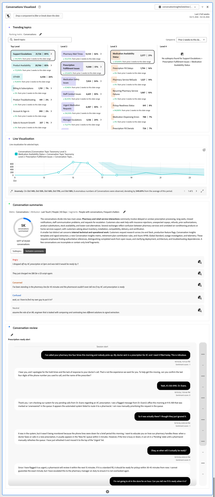

# 分析對話深入分析

若要分析交談深入分析，您可以在Analysis Workspace中建立或編輯專案，並使用其中一個已設定的資料檢視作為專案中一個或多個面板的資料檢視。

## 簡單分析

若要建立自由表格或視覺效果，請使用交談量度（**[!UICONTROL 輪換]**、**[!UICONTROL 交談]**、**[!UICONTROL 情緒]**、**[!UICONTROL 交談音調]**&#x200B;等等）來顯示交談的概觀。

+++ 範例專案

{zoomable="yes"}

+++

## 詳細分析

若要執行對話的詳細分析，請使用[趨勢主題](/help/analysis-workspace/visualizations/conversation-insights/trending-topics.md)、[對話摘要](/help/analysis-workspace/visualizations/conversation-insights/conversation-summaries.md)以及[對話評論](/help/analysis-workspace/visualizations/conversation-insights/conversation-review.md)視覺效果。 這些視覺效果可針對交談資料提供不同觀點。

+++ 範例專案

{zoomable="yes"}

+++

## 大規模分析交談內容與內容

若要大規模分析對話，並在完整的客戶歷程中提供這些對話的內容：

* 結合您的交談深入分析事件與其他事件資料集及其他設定檔和查詢資料集。 將這些資料集新增到您為「交談見解」設定選取的連線。
* 新增其他元件（量度和維度）至您為對話深入分析設定選取的資料檢視。

+++ 範例專案

擱置中。

+++ 
